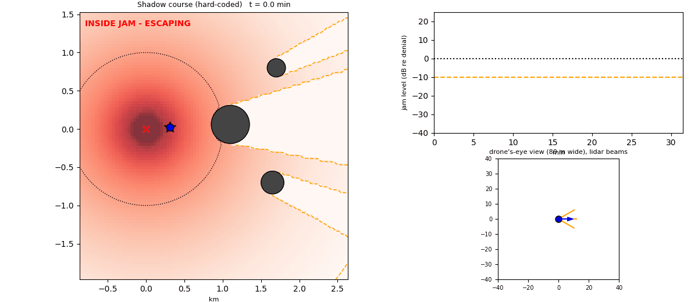

# 🕊️ Carrier Pigeon Drone

**Autonomous extraction for soldiers isolated in GPS-denied, jammed combat zones.**
A pocket-sized drone launched silently by the soldier flies itself *out* of the jamming, using terrain to
shadow enemy EW, then fires a short directional burst to friendly forces carrying the soldier's message and
a reconstructed path back to their location.

## ▶️ Watch the demo

**🎬 [youtube.com/watch?v=EcknydWgook](https://www.youtube.com/watch?v=EcknydWgook)**

📄 Full deck: [Carrier Pigeon Drone — Tactical Architecture & EW Resilient Design (PDF)](./Carrier%20Pigeon%20Drone_%20Tactical%20Architecture%20%26%20EW%20Resilient%20Design.pdf)

---

## The problem
- **GPS and radio are jammed:** no navigation, no way to call for rescue.
- **Cut off behind enemy lines:** the soldier can't broadcast their position for CSAR.
- **Transmitting is dangerous:** any RF emission is a beacon for artillery or FPV strikes.

## How it works
1. **Launch & conceal:** the soldier loads a status message (1-click ATAK / NFC) and launches from cover under zero-RF silence.
2. **Flee the jam:** reads jamming strength as it flies, fits a 1/d² model to locate the jammer, and heads away from it at ~15 m above ground.
3. **Use terrain shadows:** steers behind buildings, ridges and tree lines, which attenuate jamming by 20–45 dB.
4. **Burn-through & handoff:** once clear (or at 15% battery), it sends a 50 ms frequency-hopping burst on a 1 W, +7 dBi printed Yagi to a friendly mast with the message and its IMU + visual-odometry path, so rescuers can **backtrack to the soldier**.

## Simulation results (concept feasibility, simulation only)
120 randomized flights with realistic sensor noise (lidar, jam level, accelerometer), hills, ridgelines and large terrain:

| Metric | Result |
|---|---|
| Escaped the jam and landed clear | **98%** (117 / 120) |
| Soldier located within 250 m | **96%** (median error 60 m, all within 500 m) |
| Typical search radius | **~200 m** for a 3 km flight (6.8% of logged path) |

## Design at a glance
| | |
|---|---|
| Size / weight | 140 × 60 × 60 mm stowed, ~265–290 g (fits a MOLLE grenade/flashbang pouch) |
| Range | 5–8 km quad, 20–35 km VTOL tailsitter |
| Link | 1.4 GHz, 1 W, +7 dBi forward Yagi, 15–25 km line-of-sight, 3–8 km through EW |
| Navigation | No GPS reliance: 6-DOF IMU + optical-flow VIO (≈1% drift), magnetometer heading |
| Integration | ATAK, MOSA/SOSA nano-SDR, or **software-only retrofit** onto existing drones |
| Est. unit cost | ~$1,900 quad / ~$2,180 VTOL at 300+ units/yr |

## Repository
| Path | What's in it |
|---|---|
| [`jam_real.py`](jam_real.py) | Main real-units sim: jammer escape, landing, and rescue backtrack (`python3 jam_real.py`) |
| [`assorted_jam/`](assorted_jam) | Earlier escape / obstacle / shadow simulations and their GIFs and plots |
| [`lilygo/`](lilygo) | LilyGo T3 LoRa TX/RX sketches, RSSI live plotter, two-way LoRa chat (jam sensing + allied comms) |
| [`crazyflie/`](crazyflie) | Crazyflie 2.1 hardware testbed: Bluetooth keyboard control, IMU flight logging, propeller test ([README](crazyflie/README.md)) |
| [`Video.md`](Video.md) | Demo video link |

---
*CodeMetal Forge Hackathon, Team 4. Concept study; performance figures are design estimates and simulation results, not flight-tested.*
